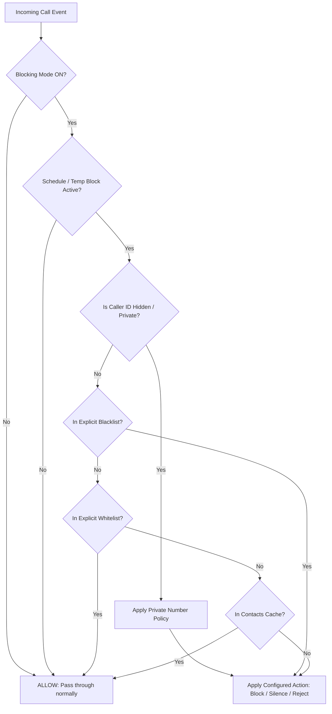

# AR Call Blocker

<div align="center">

[-3DDC84?style=for-the-badge&logo=android&logoColor=white)](https://developer.android.com)
[](https://kotlinlang.org)
[](https://developer.android.com/jetpack/compose)
[](#-privacy--security-first)
[](#-permissions-breakdown)
[](LICENSE)

**A high-performance, privacy-first, zero-cloud incoming call screening and spam blocking application for Android.**

[Key Features](#-key-features) •
[Decision Engine](#-how-it-works-the-decision-engine) •
[Architecture](#-architecture--technology-stack) •
[Permissions](#-permissions-breakdown) •
[Building & Setup](#-getting-started) •
[Testing](#-testing)

</div>

---

## 📖 Overview

Most call blockers and caller ID applications compromise your privacy by uploading your entire phonebook, call history, and telemetry to remote commercial databases.

**AR Call Blocker** takes the opposite approach:
- **100% Offline & Private:** Built with **zero network permissions** (`android.permission.INTERNET` is neither requested nor present). Your contacts, call history, and preferences never leave your phone.
- **Sub-Millisecond In-Memory Screening:** Evaluates calls via volatile in-memory sets and caches, allowing or dropping calls within milliseconds before the screen wakes or ringtone plays.
- **Official Android Telecom Integration:** Implemented natively using Android's official `CallScreeningService` API for clean, battery-efficient system-level screening without persistent background battery drain.

---

## ✨ Key Features

### 🛡️ High-Performance Call Screening
- **Ultra-Fast Hot Path:** Phone number lookups, contact matching, and policy evaluations are executed completely in-memory using concurrent hash sets.
- **Action Modes for Unknown Callers:**
  - **Block (Silent Drop):** Silently drops the call without waking the screen or vibrating.
  - **Silence (Auto-Silence):** Mutes the ringtone and vibration without alerting the user.
  - **Reject (Active Decline):** Actively sends the call straight to carrier voicemail or busy tone.
- **Fail-Open Safety Guarantee:** In the unlikely event of an unexpected runtime condition, the service automatically fails open to guarantee emergency and valid calls are never missed.

### 📋 Precision Filtering & Contact Rules
- **Contacts-Only Mode:** Automatically allow known contacts while screening non-contacts.
- **Custom Allow List (Whitelist):** Explicitly permit trusted numbers (deliveries, clinics, institutions) even if they are not stored in your device contacts.
- **Custom Block List (Blacklist):** Explicitly block numbers even if they are stored in your address book.
- **Private & Hidden Number Policies:** Dedicated rules for handling anonymous, hidden, or unavailable caller IDs (Block, Silence, Reject, or Allow).

### ⏰ Flexible Scheduling & Temporary Blocking
- **Automated Recurring Schedules:** Set custom schedules by time and day of week (e.g., Night hours, Focus sessions, Weekends).
- **One-Tap Temporary Blocking:** Enable temporary protection for quick intervals (**30 min**, **1 hour**, **2 hours**, **Until Morning**, or custom durations) with live countdown status.

### 📱 System & OS Integrations
- **Quick Settings Tile (`QS Tile`):** Toggle call blocking on/off instantly from the Android notification shade without opening the app.
- **Stealth Call Log Cleaner:** Non-system screening apps cannot completely suppress the native dialer call log; AR Call Blocker includes an automated background cleaner that removes screened call entries from the system dialer log.
- **Custom Notification Delivery:** Configurable notification modes (per-call alerts, daily summary, or completely silent).

### 🔐 Biometric Security & App Lock
- **Biometric Authentication:** Guard call logs, settings, and allow/block lists with Android BiometricPrompt (Fingerprint, Face Unlock) or device PIN/Pattern.
- **Custom Auto-Lock Timeouts:** Configure lock timeouts (Immediately, 30 seconds, 1 minute, 5 minutes).

### 🩺 Comprehensive Diagnostics Dashboard
- **Cache Health:** Real-time visibility into contact cache synchronization, indexed number counts, and hash table states.
- **Device & Role Status:** Immediate verification of Android Telecom `RoleManager` status and system permission states.
- **Live Debug Logs:** In-app formatted diagnostics logger for troubleshooting without requiring a PC connection.

---

## 🧠 How It Works: The Decision Engine

When an incoming call arrives, Android Telecom binds to `ARCallScreeningService`. The decision engine evaluates rules through a strict, deterministic hierarchy:



> **Performance Note:** All checks in this flow operate against in-memory volatile caches (`ConcurrentHashMap` / `HashSet`). Database reads and notification dispatches occur asynchronously on background coroutine dispatchers *after* the decision is communicated to the Android Telecom framework.

---

## 🏗 Architecture & Technology Stack

The project adheres to **Clean Architecture**, **MVVM (Model-View-ViewModel)**, and **Unidirectional Data Flow (UDF)** principles:

```
app/src/main/java/com/asrou/arcallblocker/
├── core/
│   ├── di/               # Dagger-Hilt dependency injection modules
│   ├── model/            # Pure domain models (BlockDecision, BlockReason, Policies)
│   └── util/             # E.164 phone normalizer and secure privacy logger
├── data/
│   ├── cache/            # Low-latency in-memory ContactCache
│   ├── contacts/         # Contacts Provider repository and ContentObserver
│   ├── datastore/        # Jetpack DataStore Preferences with fast volatile mirror
│   ├── db/               # Jetpack Room entities, DAOs, and AppDatabase
│   └── repository/       # Repositories for Blacklist, Whitelist, Schedules, History
├── domain/               # Pure business logic (BlockingEngine, ScheduleEvaluator)
├── notification/         # Silent blocked-call notifier & channels
├── security/             # BiometricAuthManager & AppLockManager
├── telecom/              # ARCallScreeningService & asynchronous CallLogCleaner
├── tile/                 # Quick Settings Tile Service (BlockingTileService)
└── ui/                   # Jetpack Compose UI screens, ViewModels, and theme
```

### Tech Stack Details

| Component | Library / Framework | Purpose |
|---|---|---|
| **Language** | Kotlin 2.0.21 | Modern, expressive language with Coroutines & StateFlow |
| **UI Framework** | Jetpack Compose (BOM `2024.12.01`) | Declarative, reactive UI with Material Design 3 |
| **Dependency Injection** | Dagger Hilt `2.53.1` (via KSP) | Scalable, compile-time dependency injection |
| **Local Database** | Jetpack Room `2.6.1` | Local SQLite ORM with versioned schema migrations |
| **Key-Value Storage** | Jetpack DataStore Preferences `1.1.1` | Asynchronous, type-safe settings storage |
| **Call Screening** | Android Telecom `CallScreeningService` | Official OS-level screening service |
| **Quick Settings** | Android `TileService` | Quick Settings toggle integration |
| **Biometrics** | AndroidX Biometric `1.2.0-alpha05` | Hardware-backed biometric authentication |
| **Splash Screen** | AndroidX Core SplashScreen `1.0.1` | Android 12+ backward-compatible splash animations |
| **Testing** | JUnit 4, Kotlinx Coroutines Test, Espresso | Robust unit and integration test coverage |

---

## 🔒 Permissions Breakdown

AR Call Blocker only requests permissions strictly required to perform its core duty. **It does NOT request or use `android.permission.INTERNET`.**

| Permission | Reason for Request |
|---|---|
| `READ_CONTACTS` | Allows the in-memory cache to index contact numbers so friends and family are never blocked. Contacts are never written to disk or transmitted anywhere. |
| `BIND_SCREENING_SERVICE` / Role | Allows the Android Telecom subsystem to route incoming calls to the app for immediate screening. |
| `READ_CALL_LOG` / `WRITE_CALL_LOG` | Required to remove blocked calls from the native dialer call log (Android only respects `setSkipCallLog` for default dialer apps; third-party screening apps must clean the log entry). |
| `POST_NOTIFICATIONS` | (Android 13+) Required to post silent blocked-call alerts if enabled by the user in Settings. |

---

## 🚀 Getting Started

### Prerequisites
- **Android Studio:** Ladybug (2024.2.1+) or newer
- **JDK:** Java 17 or higher
- **Android SDK:** Compile SDK 35, Minimum SDK 29 (Android 10+)

### Building from Source

1. **Clone the repository:**
   ```bash
   git clone https://github.com/your-username/ar-call-blocker.git
   cd ar-call-blocker
   ```

2. **Open in Android Studio:**
   - Select **Open an Existing Project** and navigate to the cloned folder.
   - Wait for Gradle sync to complete.

3. **Build the Debug APK via CLI:**
   ```bash
   # On Windows PowerShell
   .\gradlew.bat assembleDebug

   # On macOS / Linux
   ./gradlew assembleDebug
   ```

4. **Install onto a connected device:**
   ```bash
   .\gradlew.bat installDebug
   ```

### Device Setup After Installation
1. Launch **AR Call Blocker**.
2. Complete the onboarding wizard to grant **Contacts access** and set AR Call Blocker as your active **Caller ID & Spam / Call Screening app**.
3. *(Recommended)* Ensure battery optimization is disabled for the app in your device's system settings to prevent vendor background task killers from stopping the service.

---

## 🧪 Testing

The business rules and decision logic are decoupled from the Android framework, allowing fast, isolated JVM unit testing:

- **`BlockingEngineTest`:** Exhaustive verification of priority ordering, private number policies, allow/block list precedence, and unknown caller actions.
- **`ScheduleEvaluatorTest`:** Multi-day schedule boundaries, overnight spans, and temporary block expiration tests.
- **`ContactCacheTest`:** In-memory normalization, hash lookup speeds, and synchronization state tests.

Run all unit tests:
```bash
.\gradlew.bat test
```

---

## 🛡️ Privacy & Security First

- 🚫 **No Tracking / Analytics:** No Firebase Analytics, Crashlytics, telemetry, or third-party trackers.
- 🚫 **No Ads:** Pure utility application with zero monetization hooks.
- 🚫 **No Cloud Sync:** Your contact list and block history remain strictly in your device's encrypted application sandbox.
- 🔐 **Privacy-Masked Logging:** Internal debug logs automatically mask incoming phone numbers (e.g., `+1 555 •••• 1234`) to prevent sensitive caller numbers from appearing in system logcat.

---

## 🤝 Contributing

Contributions, bug reports, and feature suggestions are welcome!
1. Fork the Project.
2. Create your Feature Branch (`git checkout -b feature/AmazingFeature`).
3. Commit your Changes (`git commit -m 'Add some AmazingFeature'`).
4. Push to the Branch (`git push origin feature/AmazingFeature`).
5. Open a Pull Request.

---

## 📄 License

This project is licensed under the Apache License 2.0 - see the [LICENSE](LICENSE) file for details.
